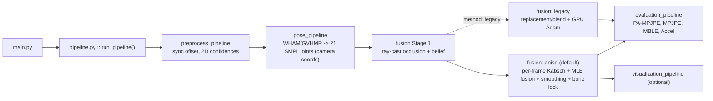

# Calibration-Free Two-View 3D Human Pose Fusion

Learning-free, **zero-ground-truth** refinement of two monocular 3D human pose reconstructions into canonical 21-joint `SMPL` trajectories, one per camera. Inputs are `WHAM` (`.pkl`) or `GVHMR` (`.pt`) outputs for two cameras that watch the same person.

The default fusion (`fusion.method: aniso`) is a closed-form maximum-likelihood estimator. It needs **no camera intrinsics, no extrinsics and no training**. The older two-stage pipeline (ray-cast replacement + GPU Adam) is still available as `fusion.method: legacy`.

---

## Design Principles

1. **No camera parameters.** The camera2→camera1 rotation is estimated from the body itself, frame by frame. Each joint's viewing ray comes straight from its camera-frame position.
2. **Zero ground truth at runtime.** Only [evaluation_pipeline/executor.py](evaluation_pipeline/executor.py) reads `ground_truth_dir`. [tests/test_regressions.py](tests/test_regressions.py#L184) checks that `fusion_pipeline` and `pose_pipeline` never touch it.
3. **Generalization over tuning.** Design decisions are made on a fixed design split. Results are then reported on held-out cameras and datasets with a **frozen** config (see [Results](#results)).
4. **Self-calibration instead of hand-tuned weights.** The noise levels of the two cameras are estimated by maximum likelihood from their cross-view disagreement.

---

## Pipeline



| Stage | Entry point | Role |
| :--- | :--- | :--- |
| Config & compat | [config_loader.py](config_loader.py), [compat.py](compat.py#L139) | Loads YAML with `${ENV:-default}` support. Normalizes WHAM `.pkl` / GVHMR `.pt` (`smpl_params_incam`) into one SMPL payload. Resolves `inputs.target_person` to the matching `.pt` file (e.g. `..._aria01.pt` → `..._aria02.pt`). |
| Preprocess | [run_preprocess()](preprocess_pipeline/executor.py#L144) | Estimates the cross-camera temporal offset and extracts per-joint 2D confidence profiles. |
| Pose export | [run_pose_export()](pose_pipeline/executor.py#L100) | SMPL forward kinematics in camera coordinates (`use_world_coords: false`), writing synchronized 21-joint `pose_data_*.json`. |
| Fusion Stage 1 | [run_phase3_pipeline()](fusion_pipeline/executor.py#L352) | Per-joint occlusion by ray-casting against the SMPL torso hull ([detector.py](fusion_pipeline/detector.py#L121)), plus a belief that combines distance-aware harmonic precision with 2D confidence ([detector.py](fusion_pipeline/detector.py#L183)). |
| Fusion (aniso) | [run_aniso_fusion()](fusion_pipeline/aniso.py#L266) | Recomputes all keypoints from the raw monocular poses, using Stage-1 beliefs as weights. Writes `fused_results/aniso_fusion_info.json` (estimated noise, view angle, λ). |
| Evaluation | [run_evaluation()](evaluation_pipeline/executor.py#L418) | The only GT consumer. Reports overall / visible / occluded PA-MPJPE, MPJPE, MBLE and Accel for `monocular` vs `fused`. |

`learnable` (NetBody25) and `selective_joint_fusion` (V3) are experimental and **disabled**. Turning on `selective_joint_fusion` makes the code fall back to the legacy path.

---

## Default Fusion: Anisotropic MLE (`fusion.method: aniso`)

Source: [fusion_pipeline/aniso.py](fusion_pipeline/aniso.py). Each camera's monocular skeleton is treated as a Gaussian measurement of one shared root-relative skeleton.

1. **Root-relative coordinates.** Subtract the hip midpoint from each camera's joints: $X_i = P_i - r_i$.
2. **Per-frame robust alignment.** For every frame, estimate $R_t$ (camera2→camera1) with weighted Kabsch over all joints and 5 Cauchy IRLS iterations. Weights are $\min(w_1, w_2)$. One sequence-level rotation is not enough, because the monocular global orientation drifts 7–11° (median) between frames.
3. **Ray-aligned covariance.** With $d = P/\|P\|$ and belief $w$ (Stage-1 confidence × occlusion factor, clipped to $[0.05, 1]$):
   $$\Sigma_i = \frac{a_i^2 (I - dd^\top) + b_i^2\, dd^\top}{w_i}$$
   Here $a_i$ is the lateral noise and $b_i$ the depth noise.
4. **Self-calibration.** Estimate $a_1, b_1, a_2, b_2$ by maximum likelihood on the cross-view residuals $X_1 - R_t X_2$. Residuals above `max_residual_m` (0.5 m) are ignored.
5. **Fusion.** $X^* = (\Lambda_1 + \Lambda_2')^{-1}(\Lambda_1 X_1 + \Lambda_2' R_t X_2)$, with $\Lambda = \Sigma^{-1}$. The result is mapped back into each camera frame and the camera's own root is added back.
6. **Smoothing and bone lock.** A closed-form 2nd-order (acceleration) smoother runs on the absolute trajectories (banded solve, $\lambda = 0.5$). Bone lengths are then projected onto the monocular SMPL lengths (`enforce_bone_lengths: true`).

Stage 2 (Adam) and Savitzky-Golay are skipped in this mode.

### Config (`fusion.aniso` in [configs/pipeline.yml](configs/pipeline.yml))

| Key | Default | Meaning |
| :--- | :--- | :--- |
| `rotation_window` | `0` | `0` = one rotation per frame; `N > 0` pools ±N frames. |
| `irls_iters` | `5` | Cauchy IRLS iterations for the rotation. |
| `max_residual_m` | `0.5` | Residuals larger than this are excluded from noise self-calibration. |
| `smoothing_lambda` | `0.5` | Acceleration smoothing; `0` disables it, `"gcv"` picks λ by GCV. |
| `noise_model` | `global` | `per_joint` scales each joint's covariance separately (not adopted, see below). |
| `bone_lengths` | `mono` | `shared` uses one time-constant length per bone (not adopted). |

---

## Results

All numbers come from the official `run_evaluation`. Each row averages over cases, where a case is one scenario × one camera.

### Design split: MMA `cam01+02`, `cam19+20` × `aria01`, `aria02` (GVHMR, 741 frames, 8 cases)

| Method | PA-MPJPE | PA occl. | MPJPE | MPJPE occl. | MBLE | Accel |
| :--- | ---: | ---: | ---: | ---: | ---: | ---: |
| Monocular | 77.93 | 98.31 | 103.52 | 131.78 | 37.08 | 97.64 |
| `legacy` | 73.71 | 90.73 | 99.89 | 120.39 | 37.08 | 92.87 |
| **`aniso`** | **68.27** | **73.20** | **94.71** | **103.08** | 37.08 | **45.13** |

Units are mm and mm/frame². These numbers are optimistic, because the design choices were made on this split.

### Held-out (frozen config, never used during design)

| Held-out set | Cases | PA-MPJPE legacy → aniso | MPJPE legacy → aniso | Accel legacy → aniso | aniso wins (PA) |
| :--- | ---: | :---: | :---: | :---: | :---: |
| MMA, 8 unseen camera pairs (`cam03`–`cam18`) × 2 subjects, GVHMR | 32 | 71.90 → **68.53** | 98.94 → **95.63** | 97.45 → **46.97** | **32/32** |
| Harmony4D Hugging, 3 pairs × 2 subjects, WHAM | 12 | 49.60 → **47.72** | 64.45 → **59.51** | 24.97 → **11.59** | 5/12 |
| MPI-INF-3DHP, GT re-synced by DTW (seg 1/6/11), WHAM | 36 | 83.23 → **82.46** | 129.09 → 129.67 | 50.15 → **35.23** | 27/36 |

* **Sensitivity.** On MMA held-out, every variant tried gives PA 67.6–69.7 mm, and all of them beat legacy (71.9). The variants cover λ ∈ [0, 2], 1–10 IRLS iterations, residual threshold 0.3–1.0 m, rotation window ±2, and an isotropic covariance. λ trades PA against Accel monotonically.
* **Ablation.** Most of the gain comes from per-frame robust alignment combined with inverse-variance weighting. Separating out the depth direction adds about 1.5 mm PA. Beliefs add about 1.4 mm PA overall and about 3.4 mm on occluded joints.

### Known Limitations

* **One consensus skeleton for both cameras.** When one view is clearly better than the other, aniso drags the better view down. This is why Hugging wins only 5/12 cases. With two views, the cross-view residual measures the *total* error but cannot say which camera is wrong. The anisotropic split did not generalize reliably either: on Hugging, the isotropic variant scored 46.83 vs 47.72.
* **MPI has a low ceiling.** The two WHAM views agree within about 28 mm PA, so even an oracle average of the two views gains only about 2 mm. Most of the remaining error is shared by both views: hip-convention bias, residual GT sync error, and the WHAM prior. Also, the WHAM segments in `input/MPI` are not frame-aligned with their same-named GT files, so naive evaluation gives about 189 mm PA. See `scratch/mpi_sync_build.py` and `scratch/mpi_sync_gt.py`.
* **Fusion does not change MBLE.** Bone lengths are locked to the monocular SMPL lengths. The main MBLE error is a joint-convention mismatch with GT (thigh and upper arm too short, shank and forearm too long). Feeding in the subject's height fixes almost nothing: PA is unchanged and MPJPE moves by less than 1 mm (`scratch/height_oracle.py`).
* λ = 0.5 is a hand-chosen value.

### Evaluation Notes

* **Accel.** Predictions are in camera coordinates and GT is in world coordinates. Before acceleration is compared, one rotation per (camera, module) sequence is fitted ([_estimate_sequence_rotation()](evaluation_pipeline/executor.py#L158)). Accel values from before this fix are not comparable with the tables above.
* **brute_force_runner.py** ranks camera pairs by GT. That is oracle selection, so do not report it as a model result.

---

## Legacy Fusion (`fusion.method: legacy`)

This is the previous default, kept for comparison:

1. **Stage 1, per frame.** RANSAC-Umeyama isometric alignment on torso landmarks. Kinematic bone-vector transfer around the parent joint, $\hat P(c) = P_{tgt}(p) + R\,(P_{src}(c) - P_{src}(p))$. Symmetric *occluded rescue* plus belief-weighted *visible consensus* ([_fuse_single_view()](fusion_pipeline/correction.py#L384)), gated by hinge angles (30°–175°) and a ±20% bone-length check.
2. **Stage 2, per sequence.** GPU Adam ([optimize_sequence_gpu()](fusion_pipeline/optimization.py#L205); `lr = 0.01`, 35 iterations) minimizing belief-weighted proximity + 2nd-order acceleration ($\lambda = 0.03$) + bone length + multi-view torso distance. This is followed by the hard bone-length projection [_enforce_bone_lengths()](fusion_pipeline/executor.py#L624).

The full history and rationale are in [MODEL_CHANGES.md](MODEL_CHANGES.md).

---

## Project Structure

```text
optimization_model_monocular_3/
├── main.py                      # CLI entry point (--config configs/pipeline.yml)
├── pipeline.py                  # preprocess -> pose -> fusion -> evaluation / visualization
├── config_loader.py             # YAML loader, ${ENV:-default}, target_person path resolution
├── compat.py                    # WHAM .pkl / GVHMR .pt adapter, NumPy/inspect shims
├── configs/
│   ├── pipeline.yml             # Active config (fusion.method: aniso)
│   ├── keypoints3D_map.yml      # 21 SMPL joints + evaluation skeleton
│   ├── keypoints2D_map.yml      # 2D detector keypoint mapping
│   └── brute_force*.yml         # Multi-pair sweep configs (Harmony4D, MMA)
├── preprocess_pipeline/         # Temporal sync, 2D confidence profiles
├── pose_pipeline/               # SMPL forward kinematics -> pose_data_*.json
├── fusion_pipeline/
│   ├── aniso.py                 # Default: calibration-free anisotropic MLE fusion
│   ├── detector.py              # Ray-cast occlusion, harmonic precision belief
│   ├── correction.py            # Legacy: RANSAC-Umeyama, bone transfer, _fuse_single_view
│   ├── optimization.py          # Legacy: GPU Adam sequence optimizer
│   ├── executor.py              # run_fusion(): Stage 1 + method dispatch + bone lock
│   ├── selective.py, diagnostics.py  # Experimental V3 selective fusion (disabled)
│   └── config.py                # Thresholds and constants
├── learnable_pipeline/          # NetBody25 refiner (disabled)
├── evaluation_pipeline/         # GT evaluation -> evaluation_results/*.csv
├── visualization_pipeline/      # Optional 2D/3D rendering
├── tests/                       # 67 tests (aniso, regressions, selective)
├── scratch/                     # Experiment scripts: held-out runner, ablations, MPI sync, height oracle
└── MODEL_CHANGES.md             # Change log and analysis (Vietnamese)
```

---

## Quickstart

### 1. Setup

```bash
pip install -r requirements.txt
```

Put `SMPL_NEUTRAL.pkl`, `smpl_partSegmentation_mapping.pkl` and `J_regressor_smpl_45.npy` under `models/`.

### 2. Run

```bash
python main.py --config configs/pipeline.yml
```

* Pick the two inputs with `inputs.cam1_pkl` / `inputs.cam2_pkl` and the subject with `inputs.target_person` (`aria01` / `aria02`). The matching sibling `.pt` file is found automatically.
* Outputs go to `output/` (`preprocess_results/`, `pose_results/`, `fused_results/`, `evaluation_results/*.csv`).
* `runtime.stage: evaluation` re-scores existing outputs without recomputing them.
* `fusion.method: legacy` switches back to the two-stage pipeline.

### 3. Tests

```bash
python -m pytest tests -q
```

Expected: **67 passed** (12 in `test_aniso_fusion.py`, 44 in `test_regressions.py`, 8 in `test_selective_fusion.py`, 3 in `test_selective_regression_guard.py`).

### 4. Reproduce the held-out benchmark

```bash
python scratch/generalization_runner.py mma_unseen   # or: hugging | mpi_design | mpi_valid | all
python scratch/generalization_summary.py
```

Results are written to `scratch/gen_runs/<suite>/<scenario>/{legacy,aniso}/evaluation_results/`.
